# Trabalho Final de Teste de Software

## Relatório da Parte 01

**Disciplina:** Teste de Software

**Grupo:** Trab_Final_3

**Sistema escolhido:** Vion, uma plataforma de preparação para o ENEM

**Repositório:** https://github.com/LucasF89k/enem-hub

**Data de entrega:** 20 de setembro de 2026

**Integrantes e divisão de tarefas:**

| Nome | Responsabilidade principal |
|------|----------------------------|
| Bianca Silva Vaz | Testes E2E |
| Gabriel Gomes Giani | Testes de API |
| Lucas Fernandes Fortuna Lourenço | Coordenação dos testes e relatório |
| Lucas de Oliveira Faustino | Testes unitários |
| Paulo Henrique Barreto da Rocha Dantas | Ambiente de testes e integração contínua |

---

# 1. Introdução ao sistema desenvolvido

## 1.1. Visão geral

O sistema que escolhemos para o trabalho é o **Vion**, uma aplicação web voltada
para estudantes que estão se preparando para o ENEM, com foco maior em quem
pretende cursar Medicina. A ideia do sistema é reunir num só lugar as
atividades que o estudante normalmente espalha entre vários aplicativos:
ler a teoria, resolver questões, revisar com flashcards, fazer simulados,
treinar redação, montar um cronograma de estudos e acompanhar o próprio
desempenho.

Dentro dos temas sugeridos no roteiro do trabalho, o Vion se encaixa em
**Educação**.

## 1.2. Objetivo do sistema

O objetivo é dar ao estudante um caminho de estudo organizado e que ele
consiga medir. Cada atividade que a pessoa conclui no sistema tem efeito em
outras partes dele:

* alimenta o histórico de desempenho por área de conhecimento;
* gera pontos de experiência (XP), que fazem o usuário subir de nível;
* mantém a sequência de dias estudados, o chamado streak;
* conta para o ranking mensal (as ligas) e para os grupos de amigos;
* influencia o planejamento de estudos, que muda conforme a data da prova
  se aproxima.

## 1.3. Principais funcionalidades

| Módulo | O que faz |
|--------|-----------|
| Autenticação | Cadastro com nome, e-mail e senha, login por credenciais e recuperação de senha por e-mail usando um token temporário. |
| Configuração inicial | Depois do cadastro o usuário informa a nota que quer atingir, o curso e a instituição desejados, a data do ENEM e quantos minutos por dia pretende estudar. |
| Estudar | Navegação em três níveis: Área, Disciplina e Tópico. Dentro de cada tópico ficam a teoria, os vídeos, os flashcards e as questões. |
| Flashcards | Baralhos de revisão com repetição espaçada. O intervalo de cada carta é calculado por um algoritmo próprio, baseado no SM-2. |
| Questões | Resolução de questões objetivas, com registro de acerto ou erro e cálculo de estatísticas por área. |
| Simulados | Provas no formato do ENEM, com cronômetro, gabarito e nota em percentual (0 a 100). |
| Redação | Editor de redação com criação, listagem, edição e exclusão. Também tem geração de tema e correção automática nas cinco competências do ENEM. |
| Planejador | Cronograma semanal. A trilha de estudos (Extensiva, Semi-extensiva, Intensiva ou Sprint) é escolhida automaticamente conforme quantos dias faltam para a prova. |
| Gamificação | XP, níveis de 1 a 99, streak de dias estudados, conquistas e ligas mensais. |
| Analytics e Perfil | Painel com minutos estudados, taxa de acerto por área, evolução nos simulados, mapa de atividade e posição no ranking. |

## 1.4. Telas do sistema

As imagens a seguir foram capturadas da versão mais recente do sistema, rodando
com o banco de dados real. O app é usado principalmente no celular, então as
telas estão no formato de tela de smartphone.

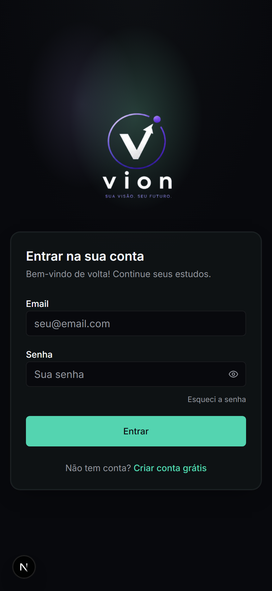{width=7cm}

**Figura 1.** Tela de login. É a porta de entrada do sistema e valida e-mail e
senha antes de liberar o acesso.

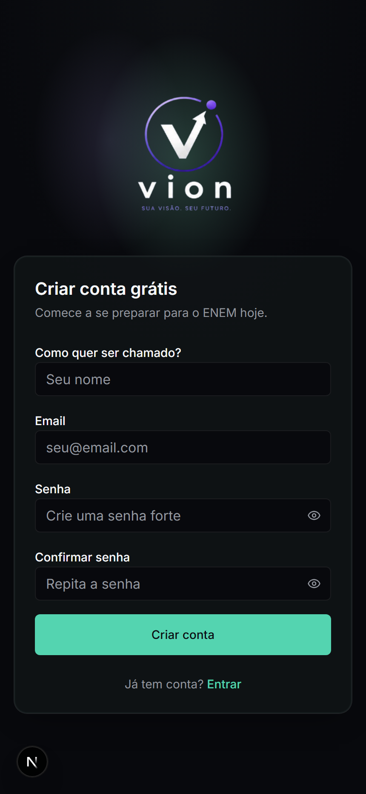{width=7cm}

**Figura 2.** Tela de cadastro. Exige nome, e-mail, senha e confirmação de
senha, com as regras de senha forte descritas na seção 1.8.

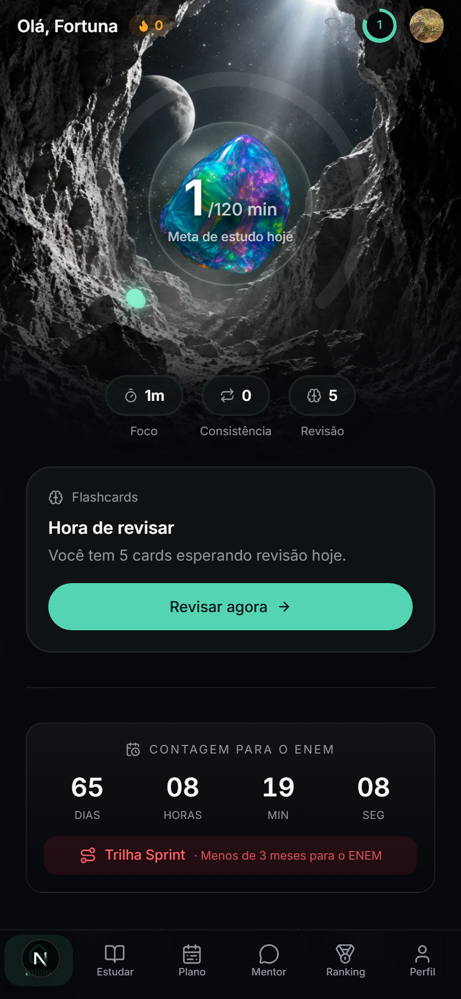{width=7cm}

**Figura 3.** Painel inicial. Mostra a meta de estudo do dia, os indicadores de
foco, consistência e revisões pendentes, a contagem regressiva para o ENEM e a
trilha de estudos ativa (aqui, a trilha Sprint).

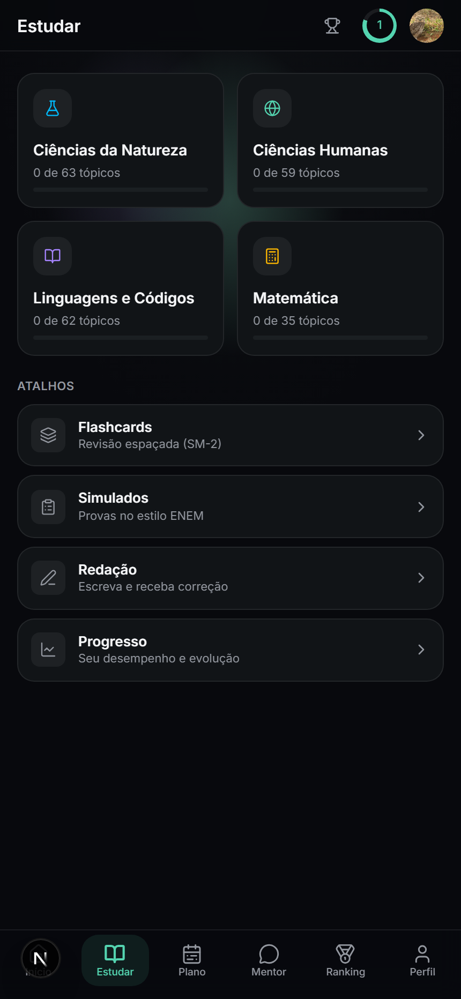{width=7cm}

**Figura 4.** Módulo Estudar. Lista as quatro áreas de conhecimento do ENEM com
o progresso em tópicos de cada uma, além dos atalhos para os outros módulos.

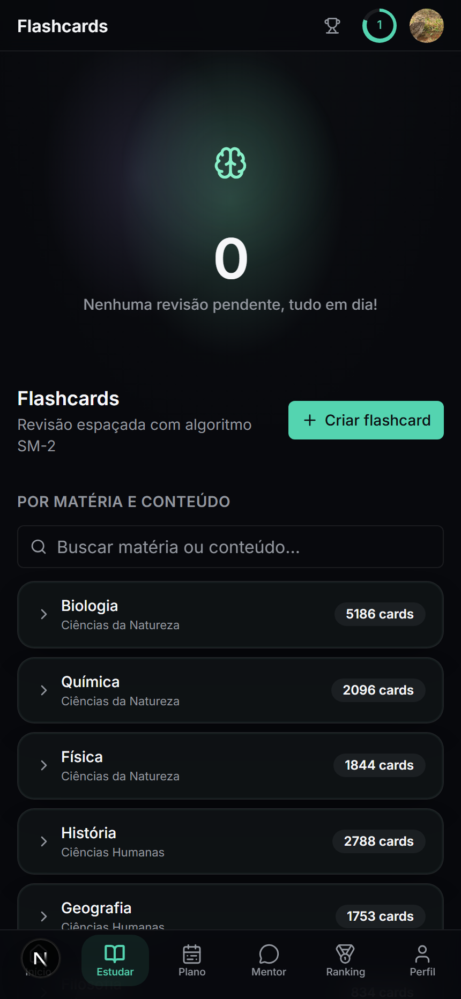{width=7cm}

**Figura 5.** Módulo Flashcards. Mostra quantas revisões estão pendentes hoje e
os baralhos organizados por matéria, com a quantidade de cartas de cada um.

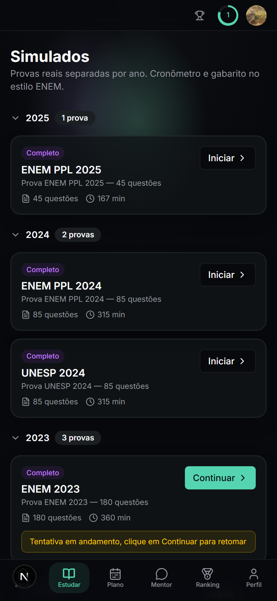{width=7cm}

**Figura 6.** Módulo Simulados. As provas ficam agrupadas por ano, com a
quantidade de questões e a duração de cada uma. Uma tentativa em andamento
aparece destacada para ser retomada.

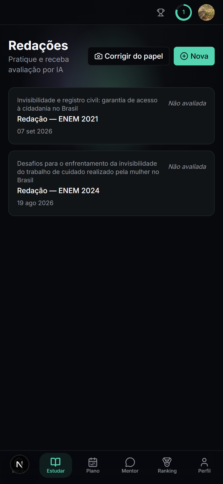{width=7cm}

**Figura 7.** Módulo Redação. É o CRUD que vamos testar: as redações do usuário
são listadas aqui, e a partir desta tela é possível criar, abrir para editar e
excluir uma redação.

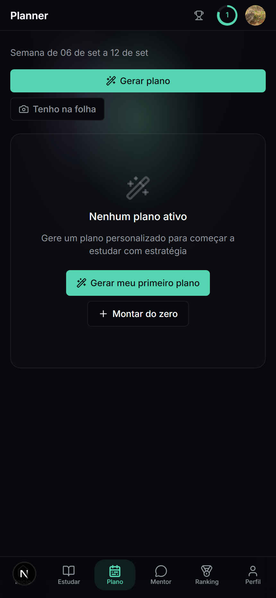{width=7cm}

**Figura 8.** Módulo Planejador. Mostra a semana atual e permite gerar um plano
de estudos. Nesta captura o usuário ainda não tem plano ativo.

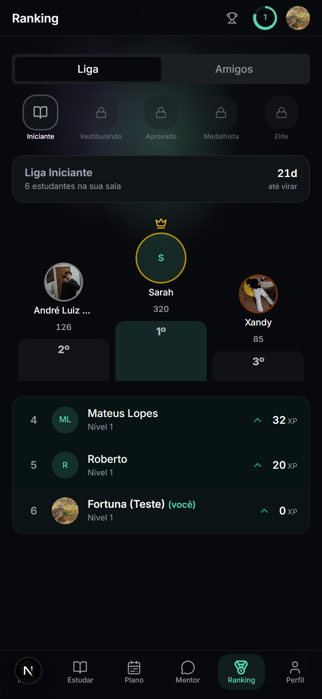{width=7cm}

**Figura 9.** Módulo Ranking. Traz a liga mensal, com o pódio da sala do usuário
e as zonas de subida e de queda, além da aba de grupos de amigos.

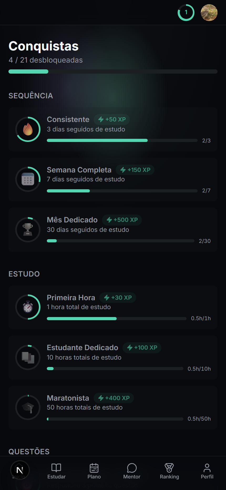{width=7cm}

**Figura 10.** Módulo Conquistas. Cada conquista mostra o XP que vale e uma
barra com o progresso do usuário até desbloqueá-la.

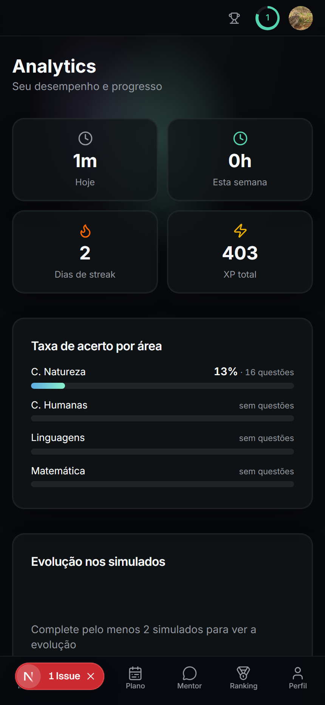{width=7cm}

**Figura 11.** Módulo Analytics. Reúne minutos estudados, dias de sequência, XP
total, taxa de acerto por área e a evolução nos simulados.

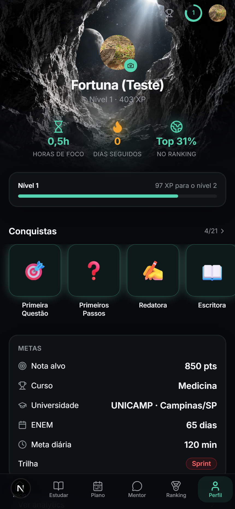{width=7cm}

**Figura 12.** Tela de perfil. Mostra o nível e o XP do usuário, as métricas de
foco e sequência, as conquistas obtidas e as metas definidas na configuração
inicial.

## 1.5. Arquitetura e tecnologias

O Vion é uma aplicação full-stack feita em **Next.js 16** usando o App Router.
O backend fica no mesmo projeto do frontend, então não existe um servidor
separado.

| Camada | Tecnologia | Para que serve |
|--------|-----------|----------------|
| Frontend | Next.js 16, React 19 e Tailwind CSS 4 | Interface web responsiva. O uso principal é pelo celular. |
| Backend e API | Route Handlers (arquivos `src/app/api/**/route.ts`) e Server Actions (`src/app/actions/**`) | São os endpoints HTTP e as funções de servidor chamadas direto pelo cliente. Toda operação que mexe em dados do usuário verifica a sessão antes. |
| Autenticação | NextAuth 5, com estratégia JWT e provedor de credenciais | A sessão fica num cookie assinado e a senha é guardada com hash bcrypt. |
| Validação | Zod 4 | Os esquemas de validação ficam em `src/lib/validations.ts` e são usados tanto no cliente quanto no servidor. |
| Banco de dados | Prisma 6 com PostgreSQL (hospedado no Neon) | Cerca de 30 modelos, entre eles `User`, `UserProfile`, `Area`, `Discipline`, `Topic`, `Flashcard`, `FlashcardReview`, `Question`, `UserQuestion`, `UserSimulado`, `Essay`, `StudyPlan` e `Achievement`. |
| Recursos de IA | Cliente compatível com a API da OpenAI (modelo MiMo) e Google Gemini | Usados na correção da redação e no chat do Mentor. Não entram no escopo funcional que vamos testar. |
| Testes | Vitest 4 com cobertura V8 | Já estava configurado no projeto, com testes das regras de negócio da pasta `src/lib/`. |

## 1.6. Como o sistema atende os requisitos mínimos do roteiro

| Requisito pedido no roteiro | Onde está no Vion |
|-----------------------------|-------------------|
| Tela de login | Rota `/login` com formulário de e-mail e senha, e `/register` para o cadastro. |
| CRUD com consulta, registro, update e deleção | O módulo de Redação faz o ciclo completo: criar (`createEssay`), consultar (listagem em `/redacao` e detalhe em `/redacao/[id]`), atualizar o texto (`saveEssayBody`) e excluir (`deleteEssay`). Notas, Flashcards e Planejador têm CRUDs parecidos. |
| Interface de usuário (frontend ou CLI) | Interface web em Next.js e React. |
| Backend com API | Route Handlers em `src/app/api/`, como o `GET /api/profile`, além das Server Actions. |
| Banco de dados | PostgreSQL, acessado pelo Prisma. |

## 1.7. Regras de negócio que vamos testar

Três partes do sistema concentram a lógica mais complicada, e por isso são o
foco dos testes unitários.

### 1.7.1. Cálculo do nível a partir do XP

A função `calcLevel` calcula o nível assim:

* nível = parte inteira de (XP total dividido por 500), mais 1;
* o nível máximo é 99;
* então cada 500 pontos de XP sobem um nível, e quem está com XP zero fica
  no nível 1.

### 1.7.2. Sequência de dias estudados (streak)

A função `effectiveStreak` decide se o streak gravado no perfil ainda vale:

* o valor só é considerado válido se a última atividade que conta aconteceu
  hoje ou ontem, usando o fuso de Brasília (UTC-3);
* se passou um dia inteiro sem atividade válida, o streak efetivo vira 0.
  Isso é feito na hora da leitura, então não precisa de nenhuma rotina
  rodando de madrugada;
* só atividades de prática contam para o streak: `QUESTIONS`, `FLASHCARDS`,
  `SIMULADO` e `REDACAO`. Ler teoria (`CONTENT`) e revisão genérica
  (`REVISION`) não contam.

### 1.7.3. Escolha da trilha de estudos

A trilha define como o tempo de estudo é dividido entre teoria, questões,
flashcards e simulados. A função `detectTrail` escolhe a trilha pela
quantidade de dias que faltam até o ENEM:

| Dias até o ENEM | Trilha escolhida |
|-----------------|------------------|
| Nenhuma data definida | Extensiva |
| Menor que 0 (a prova já passou) | Sprint |
| De 0 a 89 | Sprint |
| De 90 a 179 | Intensiva |
| De 180 a 269 | Semi-extensiva |
| 270 ou mais | Extensiva |

### 1.7.4. Agendamento dos flashcards

A função `sm2` recebe a nota que o usuário deu para a carta (1 para Errei,
2 para Difícil, 3 para Bom e 4 para Fácil), a estabilidade anterior (o
intervalo em dias) e a dificuldade atual (de 1 a 10). Ela devolve o próximo
intervalo, a nova dificuldade e o estado da carta, que pode ser `LEARNING`
ou `REVIEW`. As regras são:

* **Errei (1):** o intervalo volta para 1 dia, a dificuldade sobe 0,2 e o
  estado fica `LEARNING`;
* **Difícil (2):** o intervalo é a parte inteira de estabilidade vezes 1,2 e
  a dificuldade sobe 0,1;
* **Bom (3):** o intervalo é a parte inteira de estabilidade vezes um fator,
  onde o fator é 1 mais (dificuldade menos 5) vezes 0,1, limitado entre 0,5 e
  1,5. A dificuldade não muda;
* **Fácil (4):** o intervalo é a parte inteira de estabilidade vezes 1,3
  vezes 1,3, e a dificuldade cai 0,1.

Em todos os casos o intervalo mínimo é de 1 dia e a dificuldade fica sempre
entre 1 e 10.

## 1.8. Validações de entrada da autenticação

Ficam no arquivo `src/lib/validations.ts`, feitas com Zod:

| Campo | Regra |
|-------|-------|
| `name` | No mínimo 2 e no máximo 80 caracteres. |
| `email` | Tem que estar num formato válido de e-mail. |
| `password` no cadastro | No mínimo 8 caracteres, com pelo menos uma letra maiúscula e pelo menos um número. |
| `confirmPassword` | Tem que ser igual ao campo `password`. |
| `password` no login | Não pode estar vazio. |

---

# 2. Planejamento de testes

## 2.1. Objetivo dos testes

O objetivo é verificar se as funcionalidades principais do Vion funcionam de
acordo com as regras que descrevemos, dando prioridade para:

1. **As regras de gamificação e de estudo**, ou seja, o cálculo de nível, o
   streak, a escolha da trilha e o agendamento dos flashcards. É a parte com
   mais lógica no sistema e é o que o usuário percebe mais rápido quando
   está errado.
2. **A autenticação e a validação de entrada**, porque é a porta de entrada do
   sistema e tem regras de segurança envolvidas, como exigir senha forte e
   não deixar vazar se um e-mail está ou não cadastrado.
3. **O CRUD pela API e pelas Server Actions**, testando o ciclo completo da
   Redação e conferindo se cada operação respeita o dono do recurso.
4. **Os fluxos completos de ponta a ponta**, que são os caminhos que um
   usuário de verdade percorre na tela: se cadastrar, entrar, navegar pelo
   conteúdo e concluir uma atividade.

Não é nosso objetivo chegar a 100% de cobertura de código. A ideia é cobrir
bem os pontos de maior risco com casos claros e que qualquer um do grupo
consiga repetir.

## 2.2. Escopo do teste

### 2.2.1. O que será testado

| Item | O que é | Tipo de teste |
|------|---------|---------------|
| E1 | `calcLevel`, cálculo de nível pelo XP | Unitário |
| E2 | `effectiveStreak`, validade da sequência de dias | Unitário |
| E3 | `detectTrail` e `getTrailConfig`, escolha da trilha pela data | Unitário |
| E4 | `sm2`, agendamento da repetição espaçada | Unitário |
| E5 | Esquemas Zod de login e de cadastro | Unitário |
| E6 | `register`, cadastro de usuário e e-mail já existente | API |
| E7 | `login`, com credenciais certas e erradas | API |
| E8 | `requestPasswordReset` e `resetPassword`, recuperação de senha | API |
| E9 | `GET /api/profile`, retorno do perfil e bloqueio sem sessão | API |
| E10 | CRUD de Redação: `createEssay`, listagem, `saveEssayBody` e `deleteEssay` | API |
| E11 | Cadastro de novo usuário pela tela | E2E |
| E12 | Login e acesso ao painel inicial | E2E |
| E13 | Login com senha errada e a mensagem de erro | E2E |
| E14 | Navegação de Área para Disciplina e depois Tópico | E2E |
| E15 | Criar, editar e excluir uma redação pela tela | E2E |

### 2.2.2. O que não será testado

* **As integrações com IA** (correção da redação e o chat do Mentor). Elas
  dependem de serviços externos pagos e não devolvem sempre a mesma resposta,
  então não dá para testar de forma confiável. Quando estiverem no caminho de
  algum teste, vamos substituir por mock.
* **O envio real de e-mail** pelo provedor. Vamos mockar a função de envio e
  testar só a lógica que vem antes dela, que é a geração do token e o
  controle de expiração.
* **Partes só visuais**, como tema, animação de abertura e paleta de cores.
  Não têm regra de negócio para verificar.
* **Compatibilidade entre navegadores e vários tamanhos de tela.** Os testes
  E2E vão rodar só no Chromium.
* **Desempenho, carga e testes de segurança ofensiva**, que estão fora do que
  a disciplina pede.
* **Os painéis de Analytics e de Ranking em detalhe.** São agregações de
  dados só de leitura, então vamos passar por eles de forma superficial nos
  testes E2E.

## 2.3. Ferramentas que vamos usar

| Para que | Ferramenta | Por que escolhemos |
|----------|-----------|--------------------|
| Testes unitários | Vitest 4 com `@vitest/coverage-v8` | Já estava configurado no projeto, no arquivo `vitest.config.mts`. A API é parecida com a do Jest, roda rápido e já entende TypeScript e os atalhos de importação do projeto, como o `@/`. |
| Testes de API | Vitest com mock do Prisma Client, e Supertest para os Route Handlers | Dá para testar as funções de servidor sem depender do banco de verdade. O Supertest cobre o endpoint REST do perfil. |
| Testes E2E | Playwright | É uma das opções recomendadas no roteiro. Roda num navegador de verdade e grava vídeo, trace e prints automáticos quando um teste falha, o que já serve de evidência. |
| Cobertura de código | Cobertura V8, pelo próprio Vitest | Gera relatório em texto e em HTML. Já está pronto no comando `npm run test:coverage`. |
| Controle de versão | Git e GitHub | É onde ficam o código e a documentação do trabalho. |
| Integração contínua (opcional) | GitHub Actions | Para rodar a suíte automaticamente a cada push e publicar o relatório de cobertura. |

## 2.4. Estratégia de testes

### 2.4.1. Níveis de teste

1. **Testes unitários.** Testam as funções puras da pasta `src/lib/`, que são
   as regras de negócio. Não usam banco nem rede. Aqui aplicamos partição de
   equivalência e análise de valor limite. Por exemplo, testar o XP exatamente
   em 499 e 500, e os dias até a prova em 89, 90, 179, 180, 269 e 270.
2. **Testes de API.** Testam as Server Actions e os Route Handlers. O Prisma
   Client é trocado por um mock, o que deixa a gente simular situações como
   "esse e-mail já existe" ou "esse token expirou" sempre do mesmo jeito.
   Também conferimos o controle de acesso, verificando se a resposta é 401
   quando não tem sessão.
3. **Testes E2E.** Testam os fluxos completos pela interface, com um banco de
   testes populado pelo seed. Simulam o usuário preenchendo formulário,
   clicando, navegando e conferindo o que aparece na tela.

### 2.4.2. Abordagem

* Usamos principalmente **caixa-preta**: os casos saem dos requisitos e das
  regras de negócio, sem olhar como a função foi escrita por dentro.
* Usamos **caixa-branca** como complemento: o relatório de cobertura mostra
  quais caminhos das funções críticas não foram exercitados, e a partir daí
  criamos casos extras.
* Para os dados de teste, usamos entradas mínimas, típicas e de fronteira em
  cada partição. Nos testes E2E, os usuários são criados na hora ou vêm do
  seed.
* Cada teste prepara o próprio estado e não depende da ordem em que roda.

### 2.4.3. Critérios de entrada e de saída

**Para começar a executar os testes:**

* o código das funcionalidades do escopo está na branch principal;
* a aplicação sobe local com `npm run dev` sem erro;
* o banco de testes está criado e populado pelo seed.

**Para considerar a fase de testes encerrada:**

* todos os casos planejados foram executados;
* todos os casos de prioridade alta passaram;
* os defeitos de severidade alta foram corrigidos e testados de novo, ou
  então registrados e aceitos pelo grupo;
* a cobertura de linhas das funções críticas de `src/lib/` está em pelo menos
  80%;
* as evidências (logs, prints e relatório de cobertura) estão salvas no
  repositório.

### 2.4.4. Quando um caso de teste passa

Um caso passa quando a saída observada é igual à saída esperada descrita nele,
sem nenhuma exceção não tratada, e quando o efeito colateral esperado (se
houver) realmente aconteceu. Se qualquer uma dessas condições falhar, o caso
falha e abrimos um registro do defeito com os passos para reproduzir.

## 2.5. Papéis e responsabilidades no grupo

| Papel | O que faz | Responsável |
|-------|-----------|-------------|
| Coordenação dos testes | Montar o plano, definir escopo e critérios, revisar os casos e organizar o relatório final. | Lucas Fernandes Fortuna Lourenço |
| Testes unitários | Escrever e manter os testes da pasta `src/lib/` no Vitest e acompanhar a cobertura. | Lucas de Oliveira Faustino |
| Testes de API | Escrever os testes das Server Actions e dos Route Handlers e configurar os mocks do Prisma e do e-mail. | Gabriel Gomes Giani |
| Testes E2E | Configurar o Playwright, escrever os fluxos completos e guardar os prints e traces como evidência. | Bianca Silva Vaz |
| Ambiente e integração contínua | Preparar o banco de testes e o workflow do GitHub Actions, garantindo que a suíte rode igual em qualquer máquina. | Paulo Henrique Barreto da Rocha Dantas |

Todo mundo do grupo participa da escrita dos casos de teste e da análise dos
resultados. Os papéis acima indicam quem é o responsável principal por cada
frente, não a única pessoa que trabalha nela.

---

# 3. Descrição dos casos de teste

Cada caso segue o formato que o roteiro pede: identificador, descrição, passos
para execução, dados de entrada e saída esperada, e critério de sucesso.

Os identificadores usam um prefixo por tipo de teste:

* **CTU** para caso de teste unitário;
* **CTA** para caso de teste de API;
* **CTE** para caso de teste E2E.

A prioridade pode ser **A** (alta), **M** (média) ou **B** (baixa).

---

## 3.1. Testes unitários

### CTU-01: XP zero resulta no nível 1

| Campo | Conteúdo |
|-------|----------|
| Descrição | Verificar que um usuário sem nenhum XP fica no nível 1. |
| Pré-condições | Nenhuma, porque a função é pura. |
| Passos | 1. Chamar `calcLevel(0)`. |
| Dados de entrada | `totalXP = 0` |
| Saída esperada | `1` |
| Critério de sucesso | O retorno é exatamente `1`. |
| Prioridade | A |

### CTU-02: fronteira de subida de nível entre 499 e 500

| Campo | Conteúdo |
|-------|----------|
| Descrição | Verificar o valor limite na virada do nível 1 para o nível 2. |
| Pré-condições | Nenhuma. |
| Passos | 1. Chamar `calcLevel(499)`. 2. Chamar `calcLevel(500)`. |
| Dados de entrada | `499` e `500` |
| Saída esperada | `calcLevel(499)` devolve `1` e `calcLevel(500)` devolve `2`. |
| Critério de sucesso | Os dois retornos conferem. |
| Prioridade | A |

### CTU-03: o nível não passa de 99

| Campo | Conteúdo |
|-------|----------|
| Descrição | Verificar que o nível para em 99 mesmo com um XP muito alto. |
| Pré-condições | Nenhuma. |
| Passos | 1. Chamar `calcLevel(1000000)`. |
| Dados de entrada | `totalXP = 1000000` |
| Saída esperada | `99` |
| Critério de sucesso | O retorno é exatamente `99`. |
| Prioridade | M |

### CTU-04: usuário sem data de última atividade tem streak zero

| Campo | Conteúdo |
|-------|----------|
| Descrição | Quem nunca estudou tem streak efetivo 0, não importa o valor que esteja gravado. |
| Pré-condições | Nenhuma. |
| Passos | 1. Chamar `effectiveStreak(10, null)`. |
| Dados de entrada | `streak = 10` e `lastStudyDate = null` |
| Saída esperada | `0` |
| Critério de sucesso | O retorno é `0`. |
| Prioridade | A |

### CTU-05: última atividade hoje mantém o streak

| Campo | Conteúdo |
|-------|----------|
| Descrição | Se a última atividade foi hoje no fuso de Brasília, o streak gravado continua valendo. |
| Pré-condições | Nenhuma. |
| Passos | 1. Calcular o início do dia de Brasília e guardar em `hoje`. 2. Chamar `effectiveStreak(7, hoje)`. |
| Dados de entrada | `streak = 7` e `lastStudyDate = hoje` |
| Saída esperada | `7` |
| Critério de sucesso | O retorno é `7`. |
| Prioridade | A |

### CTU-06: última atividade ontem mantém o streak

| Campo | Conteúdo |
|-------|----------|
| Descrição | Se a última atividade foi ontem, o streak ainda vale, porque a pessoa ainda pode estudar hoje. |
| Pré-condições | Nenhuma. |
| Passos | 1. Calcular o início do dia de Brasília menos um dia e guardar em `ontem`. 2. Chamar `effectiveStreak(7, ontem)`. |
| Dados de entrada | `streak = 7` e `lastStudyDate = ontem` |
| Saída esperada | `7` |
| Critério de sucesso | O retorno é `7`. |
| Prioridade | A |

### CTU-07: última atividade anteontem zera o streak

| Campo | Conteúdo |
|-------|----------|
| Descrição | Se passou um dia inteiro sem atividade que conta, o streak efetivo vira 0. |
| Pré-condições | Nenhuma. |
| Passos | 1. Calcular o início do dia de Brasília menos dois dias e guardar em `anteontem`. 2. Chamar `effectiveStreak(7, anteontem)`. |
| Dados de entrada | `streak = 7` e `lastStudyDate = anteontem` |
| Saída esperada | `0` |
| Critério de sucesso | O retorno é `0`. |
| Prioridade | A |

### CTU-08: sem data de prova a trilha é Extensiva

| Campo | Conteúdo |
|-------|----------|
| Descrição | Quando o usuário não informou a data do ENEM, a trilha padrão é a Extensiva. |
| Pré-condições | Nenhuma. |
| Passos | 1. Chamar `detectTrail(null)`. |
| Dados de entrada | `examDate = null` |
| Saída esperada | `"EXTENSIVA"` |
| Critério de sucesso | O retorno é `"EXTENSIVA"`. |
| Prioridade | M |

### CTU-09: valores de fronteira entre as trilhas

| Campo | Conteúdo |
|-------|----------|
| Descrição | Verificar os valores limite nas quatro faixas de dias até a prova. |
| Pré-condições | Nenhuma. |
| Passos | Para cada quantidade de dias, montar uma data somando esses dias à data de hoje e chamar `detectTrail` com ela. |
| Dados de entrada e saída esperada | 89 dias devolve `"SPRINT"`; 90 dias devolve `"INTENSIVA"`; 179 dias devolve `"INTENSIVA"`; 180 dias devolve `"SEMI_EXTENSIVA"`; 269 dias devolve `"SEMI_EXTENSIVA"`; 270 dias devolve `"EXTENSIVA"`. |
| Critério de sucesso | Todas as seis chamadas devolvem a trilha esperada. |
| Prioridade | A |

### CTU-10: data de prova no passado resulta em Sprint

| Campo | Conteúdo |
|-------|----------|
| Descrição | Se a data do ENEM já passou, a trilha é a Sprint. |
| Pré-condições | Nenhuma. |
| Passos | 1. Montar uma data de dez dias atrás. 2. Chamar `detectTrail` com ela. |
| Dados de entrada | Data de dez dias no passado. |
| Saída esperada | `"SPRINT"` |
| Critério de sucesso | O retorno é `"SPRINT"`. |
| Prioridade | M |

### CTU-11: configuração da trilha Sprint

| Campo | Conteúdo |
|-------|----------|
| Descrição | A configuração da trilha Sprint tem que priorizar questões e simulados. |
| Pré-condições | Nenhuma. |
| Passos | 1. Chamar `getTrailConfig("SPRINT")`. |
| Dados de entrada | `"SPRINT"` |
| Saída esperada | Um objeto com `label` igual a `"Sprint"`, `ratios.questions` igual a `0.50`, `ratios.simulados` igual a `0.25`, e a soma de todos os valores de `ratios` igual a `1`. |
| Critério de sucesso | Os campos conferem e a soma das proporções é 1. |
| Prioridade | M |

### CTU-12: nota Errei reinicia o aprendizado da carta

| Campo | Conteúdo |
|-------|----------|
| Descrição | Quando o usuário erra a carta, o intervalo volta para 1 dia, a dificuldade sobe e o estado passa a ser `LEARNING`. |
| Pré-condições | Nenhuma. |
| Passos | 1. Chamar `sm2` com nota 1, estabilidade 10, dificuldade 5 e 3 dias decorridos. |
| Dados de entrada | `rating = 1`, `stability = 10`, `difficulty = 5` e `elapsed = 3` |
| Saída esperada | `scheduled` igual a 1, `stability` igual a 1, `difficulty` perto de 5,2 e `state` igual a `"LEARNING"`. |
| Critério de sucesso | Todos os campos conferem, aceitando pequena diferença na dificuldade por causa do ponto flutuante. |
| Prioridade | A |

### CTU-13: nota Difícil multiplica o intervalo por 1,2

| Campo | Conteúdo |
|-------|----------|
| Descrição | Ao marcar Difícil, o próximo intervalo é a parte inteira de estabilidade vezes 1,2 e a dificuldade sobe um pouco. |
| Pré-condições | Nenhuma. |
| Passos | 1. Chamar `sm2` com nota 2, estabilidade 10 e dificuldade 5. |
| Dados de entrada | `rating = 2`, `stability = 10` e `difficulty = 5` |
| Saída esperada | `scheduled` igual a 12, `difficulty` perto de 5,1 e `state` igual a `"REVIEW"`. |
| Critério de sucesso | Todos os campos conferem. |
| Prioridade | A |

### CTU-14: nota Bom com dificuldade média mantém o intervalo

| Campo | Conteúdo |
|-------|----------|
| Descrição | Com dificuldade 5, o fator da nota Bom é 1, então o intervalo fica igual à estabilidade e a dificuldade não muda. |
| Pré-condições | Nenhuma. |
| Passos | 1. Chamar `sm2` com nota 3, estabilidade 10 e dificuldade 5. |
| Dados de entrada | `rating = 3`, `stability = 10` e `difficulty = 5` |
| Saída esperada | `scheduled` igual a 10, `difficulty` igual a 5 e `state` igual a `"REVIEW"`. |
| Critério de sucesso | Todos os campos conferem. |
| Prioridade | M |

### CTU-15: nota Fácil multiplica o intervalo por 1,69

| Campo | Conteúdo |
|-------|----------|
| Descrição | Ao marcar Fácil, o intervalo é a parte inteira de estabilidade vezes 1,3 vezes 1,3, e a dificuldade cai. |
| Pré-condições | Nenhuma. |
| Passos | 1. Chamar `sm2` com nota 4, estabilidade 10 e dificuldade 5. |
| Dados de entrada | `rating = 4`, `stability = 10` e `difficulty = 5` |
| Saída esperada | `scheduled` igual a 16, `difficulty` perto de 4,9 e `state` igual a `"REVIEW"`. |
| Critério de sucesso | Todos os campos conferem. |
| Prioridade | M |

### CTU-16: intervalo mínimo de um dia quando a estabilidade é zero

| Campo | Conteúdo |
|-------|----------|
| Descrição | Mesmo com estabilidade 0, o próximo intervalo nunca pode ser menor que 1 dia. |
| Pré-condições | Nenhuma. |
| Passos | 1. Chamar `sm2` três vezes, com notas 2, 3 e 4, todas com estabilidade 0. |
| Dados de entrada | `stability = 0` e `difficulty = 5` |
| Saída esperada | Nas três chamadas, `scheduled` é maior ou igual a 1. |
| Critério de sucesso | Nenhuma das chamadas devolve `scheduled` menor que 1. |
| Prioridade | A |

### CTU-17: a dificuldade fica sempre entre 1 e 10

| Campo | Conteúdo |
|-------|----------|
| Descrição | A dificuldade não passa de 10 nem fica abaixo de 1. |
| Pré-condições | Nenhuma. |
| Passos | 1. Chamar `sm2` com nota 1, estabilidade 10 e dificuldade 9,9. 2. Chamar `sm2` com nota 4, estabilidade 10 e dificuldade 1. |
| Dados de entrada | Dificuldade 9,9 com a nota Errei, e dificuldade 1 com a nota Fácil. |
| Saída esperada | No primeiro passo a dificuldade fica em 10. No segundo, fica em 1. |
| Critério de sucesso | Os dois retornos respeitam os limites. |
| Prioridade | A |

### CTU-18: cadastro com dados válidos é aceito

| Campo | Conteúdo |
|-------|----------|
| Descrição | Um cadastro com todos os campos corretos passa na validação. |
| Pré-condições | Nenhuma. |
| Passos | 1. Chamar `registerSchema.safeParse` com os dados de entrada. |
| Dados de entrada | Nome "Maria Silva", e-mail "maria@teste.com", senha "Senha123" e confirmação "Senha123". |
| Saída esperada | O campo `success` do resultado é `true`. |
| Critério de sucesso | A validação devolve `success` igual a `true`. |
| Prioridade | A |

### CTU-19: senha fraca é rejeitada no cadastro

| Campo | Conteúdo |
|-------|----------|
| Descrição | Senha sem letra maiúscula, sem número ou com menos de 8 caracteres não passa. |
| Pré-condições | Nenhuma. |
| Passos | 1. Chamar `registerSchema.safeParse` uma vez para cada senha inválida. |
| Dados de entrada | As senhas "abcdefgh" (sem maiúscula e sem número), "Abcdefgh" (sem número) e "Abc123" (curta). |
| Saída esperada | Nos três casos o `success` é `false`, com mensagem referente à senha. |
| Critério de sucesso | As três validações falham pelo motivo certo. |
| Prioridade | A |

### CTU-20: senhas diferentes são rejeitadas

| Campo | Conteúdo |
|-------|----------|
| Descrição | Se a confirmação de senha for diferente da senha, o cadastro não é validado. |
| Pré-condições | Nenhuma. |
| Passos | 1. Chamar `registerSchema.safeParse` com os dados de entrada. |
| Dados de entrada | Nome "João", e-mail "joao@teste.com", senha "Senha123" e confirmação "Outra123". |
| Saída esperada | O `success` é `false` e o erro aponta o campo `confirmPassword`, com a mensagem "As senhas não coincidem". |
| Critério de sucesso | A validação falha e indica o campo `confirmPassword`. |
| Prioridade | M |

### CTU-21: e-mail inválido é rejeitado no login

| Campo | Conteúdo |
|-------|----------|
| Descrição | Login com e-mail em formato inválido não passa na validação. |
| Pré-condições | Nenhuma. |
| Passos | 1. Chamar `loginSchema.safeParse` com e-mail "sem-arroba" e senha "123". |
| Dados de entrada | `email = "sem-arroba"` e `password = "123"` |
| Saída esperada | O `success` é `false`, com a mensagem "Email inválido". |
| Critério de sucesso | A validação falha por causa do e-mail. |
| Prioridade | M |

---

## 3.2. Testes de API

Nestes casos, o Prisma Client e o serviço de e-mail são substituídos por mocks.
As pré-condições descrevem o estado que o banco simula em cada situação.

### CTA-01: cadastro bem-sucedido cria o usuário e o perfil

| Campo | Conteúdo |
|-------|----------|
| Descrição | Com dados válidos e e-mail que ainda não existe, a ação cria o usuário com a senha protegida por hash e já cria o `UserProfile` ligado a ele. |
| Pré-condições | O mock de `db.user.findUnique` devolve `null`, indicando que o e-mail não existe. |
| Passos | 1. Chamar `register` com os dados de entrada. 2. Inspecionar como `db.user.create` foi chamado. |
| Dados de entrada | Nome "Ana", e-mail "ana@teste.com", senha "Senha123" e confirmação "Senha123". |
| Saída esperada | `db.user.create` é chamado uma vez; a senha gravada é diferente do texto "Senha123", porque está com hash; e os dados enviados incluem a criação do perfil. A ação não devolve objeto de erro. |
| Critério de sucesso | O usuário é criado com senha protegida e com o perfil junto. |
| Prioridade | A |

### CTA-02: cadastro com e-mail já usado é recusado

| Campo | Conteúdo |
|-------|----------|
| Descrição | Se o e-mail já está cadastrado, a ação devolve erro e não cria nada. |
| Pré-condições | O mock de `db.user.findUnique` devolve um usuário existente. |
| Passos | 1. Chamar `register` com um e-mail que já está em uso. |
| Dados de entrada | Nome "Ana", e-mail "existente@teste.com", senha "Senha123" e confirmação "Senha123". |
| Saída esperada | A ação devolve o erro "Este email já está em uso" e `db.user.create` não é chamado. |
| Critério de sucesso | O erro esperado é devolvido e nada é salvo no banco. |
| Prioridade | A |

### CTA-03: cadastro com dados inválidos falha antes de consultar o banco

| Campo | Conteúdo |
|-------|----------|
| Descrição | Uma entrada que não passa no esquema de validação devolve erro sem nem consultar o banco. |
| Pré-condições | Nenhuma. |
| Passos | 1. Chamar `register` com uma senha fraca. |
| Dados de entrada | Nome "Ana", e-mail "ana@teste.com", senha "fraca" e confirmação "fraca". |
| Saída esperada | A ação devolve um erro com a mensagem sobre a senha e `db.user.findUnique` não é chamado. |
| Critério de sucesso | A ação para na validação, sem tocar no banco. |
| Prioridade | M |

### CTA-04: login com credenciais certas chama o signIn

| Campo | Conteúdo |
|-------|----------|
| Descrição | Com e-mail e senha válidos, a ação chama o `signIn` mandando para o painel inicial. |
| Pré-condições | O mock de `signIn` lança a exceção de redirecionamento, que é o comportamento normal do NextAuth. |
| Passos | 1. Chamar `login` com e-mail "user@teste.com" e senha "Senha123". |
| Dados de entrada | E-mail e senha válidos, sem informar URL de retorno. |
| Saída esperada | O `signIn` é chamado com o provedor de credenciais e com destino `/dashboard`, e a exceção de redirecionamento é repassada em vez de ser tratada como erro. |
| Critério de sucesso | A chamada ao `signIn` acontece com os parâmetros esperados. |
| Prioridade | A |

### CTA-05: login com credenciais erradas devolve mensagem amigável

| Campo | Conteúdo |
|-------|----------|
| Descrição | Quando o NextAuth avisa que as credenciais estão erradas, a ação devolve a mensagem "Email ou senha incorretos". |
| Pré-condições | O mock de `signIn` lança um `AuthError` do tipo `CredentialsSignin`. |
| Passos | 1. Chamar `login` com e-mail "user@teste.com" e senha "errada". |
| Dados de entrada | E-mail válido e senha incorreta. |
| Saída esperada | A ação devolve o erro "Email ou senha incorretos". |
| Critério de sucesso | A mensagem devolvida é exatamente essa. |
| Prioridade | A |

### CTA-06: login com e-mail malformado para na validação

| Campo | Conteúdo |
|-------|----------|
| Descrição | E-mail em formato inválido devolve erro de validação sem chamar o `signIn`. |
| Pré-condições | Nenhuma. |
| Passos | 1. Chamar `login` com e-mail "invalido" e senha "123". |
| Dados de entrada | `email = "invalido"` |
| Saída esperada | A ação devolve o erro "Email inválido" e o `signIn` não é chamado. |
| Critério de sucesso | A ação falha na validação. |
| Prioridade | M |

### CTA-07: pedido de recuperação com e-mail existente gera token e dispara envio

| Campo | Conteúdo |
|-------|----------|
| Descrição | Para um e-mail cadastrado, a ação apaga os tokens antigos, cria um novo com validade de uma hora e chama o envio de e-mail. |
| Pré-condições | O mock de `db.user.findUnique` devolve um usuário, e o mock de `sendEmail` responde com sucesso. |
| Passos | 1. Chamar `requestPasswordReset` com "user@teste.com". |
| Dados de entrada | `email = "user@teste.com"` |
| Saída esperada | Primeiro é chamado o `deleteMany` dos tokens e depois o `create`; a data de expiração do token fica em torno de uma hora à frente; o `sendEmail` é chamado com o destinatário igual ao e-mail informado; e a ação devolve sucesso. |
| Critério de sucesso | O token é criado com a validade certa e o envio é acionado. |
| Prioridade | A |

### CTA-08: pedido de recuperação com e-mail inexistente não vaza informação

| Campo | Conteúdo |
|-------|----------|
| Descrição | Para um e-mail que não está cadastrado, a ação não cria token nem envia e-mail, mas ainda assim responde sucesso, para não revelar se aquela conta existe. |
| Pré-condições | O mock de `db.user.findUnique` devolve `null`. |
| Passos | 1. Chamar `requestPasswordReset` com "naoexiste@teste.com". |
| Dados de entrada | `email = "naoexiste@teste.com"` |
| Saída esperada | O `create` do token não é chamado, o `sendEmail` não é chamado, e a ação devolve sucesso. |
| Critério de sucesso | Nenhum efeito colateral acontece, mas a resposta é de sucesso. |
| Prioridade | A |

### CTA-09: pedido de recuperação com e-mail em formato inválido

| Campo | Conteúdo |
|-------|----------|
| Descrição | Uma entrada sem arroba é recusada antes de qualquer consulta ao banco. |
| Pré-condições | Nenhuma. |
| Passos | 1. Chamar `requestPasswordReset` com "texto-qualquer". |
| Dados de entrada | `email = "texto-qualquer"` |
| Saída esperada | A ação devolve falha com a mensagem "E-mail inválido", e o `db.user.findUnique` não é chamado. |
| Critério de sucesso | A ação para na validação de formato. |
| Prioridade | M |

### CTA-10: token válido permite redefinir a senha

| Campo | Conteúdo |
|-------|----------|
| Descrição | Com um token que existe e ainda não expirou, a nova senha de pelo menos 6 caracteres substitui a antiga e os tokens daquele e-mail são apagados. |
| Pré-condições | O mock de `db.passwordResetToken.findUnique` devolve um token com expiração 30 minutos à frente. |
| Passos | 1. Chamar `resetPassword` com o token válido e a senha "novaSenha1". |
| Dados de entrada | `token = "token-valido"` e `password = "novaSenha1"` |
| Saída esperada | O `db.user.update` é chamado com uma senha diferente do texto puro, porque está com hash; o `deleteMany` dos tokens é chamado; e a ação devolve sucesso. |
| Critério de sucesso | A senha é atualizada com hash e o token é invalidado. |
| Prioridade | A |

### CTA-11: token expirado não permite redefinir a senha

| Campo | Conteúdo |
|-------|----------|
| Descrição | Um token com a data de expiração no passado não deixa trocar a senha. |
| Pré-condições | O mock de `db.passwordResetToken.findUnique` devolve um token que expirou há um minuto. |
| Passos | 1. Chamar `resetPassword` com o token expirado e a senha "novaSenha1". |
| Dados de entrada | `token = "token-expirado"` |
| Saída esperada | A ação devolve falha com a mensagem "Link expirado ou inválido. Peça um novo." e o `db.user.update` não é chamado. |
| Critério de sucesso | A troca é bloqueada e a senha continua a mesma. |
| Prioridade | A |

### CTA-12: senha curta é recusada na redefinição

| Campo | Conteúdo |
|-------|----------|
| Descrição | Uma senha nova com menos de 6 caracteres é recusada antes de consultar o token. |
| Pré-condições | Nenhuma. |
| Passos | 1. Chamar `resetPassword` com qualquer token e a senha "123". |
| Dados de entrada | `password = "123"` |
| Saída esperada | A ação devolve falha com a mensagem "A senha deve ter ao menos 6 caracteres". |
| Critério de sucesso | A ação para na validação de tamanho. |
| Prioridade | M |

### CTA-13: consulta ao perfil sem sessão devolve 401

| Campo | Conteúdo |
|-------|----------|
| Descrição | Uma requisição ao endpoint de perfil sem usuário logado é bloqueada. |
| Pré-condições | O mock de `auth()` devolve `null`. |
| Passos | 1. Fazer um GET no Route Handler de `/api/profile`, usando o Supertest ou chamando a função `GET` direto. |
| Dados de entrada | Requisição sem cookie de sessão. |
| Saída esperada | Status 401 e corpo com o texto "Unauthorized". |
| Critério de sucesso | O status é 401 e nenhum dado do perfil é devolvido. |
| Prioridade | A |

### CTA-14: consulta ao perfil com sessão devolve os valores padrão

| Campo | Conteúdo |
|-------|----------|
| Descrição | Um usuário logado que ainda não tem perfil salvo recebe o JSON com os valores padrão definidos na rota. |
| Pré-condições | O mock de `auth()` devolve uma sessão com o id "u1"; o `db.user.findUnique` devolve nome "Teste" e e-mail "t@teste.com"; e o `db.userProfile.findUnique` devolve `null`. |
| Passos | 1. Fazer um GET em `/api/profile`. |
| Dados de entrada | Sessão válida. |
| Saída esperada | Status 200 e um JSON com nome "Teste", e-mail "t@teste.com", nota alvo 950, curso "Medicina", meta diária de 120 minutos e tema "dark". |
| Critério de sucesso | O corpo da resposta traz exatamente esses valores padrão. |
| Prioridade | M |

### CTA-15: criar redação salva o registro e redireciona para o editor

| Campo | Conteúdo |
|-------|----------|
| Descrição | Com tema e título válidos, a ação cria a redação com o corpo vazio e redireciona para a página do editor. |
| Pré-condições | O mock de `auth()` devolve uma sessão válida e o `db.essay.create` devolve um registro com id "e1". |
| Passos | 1. Montar um `FormData` com os campos de tema e título. 2. Chamar `createEssay` com esse formulário. |
| Dados de entrada | Tema "Os desafios da mobilidade urbana no Brasil" e título "Redação 1". |
| Saída esperada | O `db.essay.create` é chamado com o id do usuário, o tema, o título e o corpo vazio, e depois acontece o redirecionamento para `/redacao/e1`. |
| Critério de sucesso | A redação é criada e o usuário é levado para o editor. |
| Prioridade | A |

### CTA-16: criar redação sem sessão lança erro de autorização

| Campo | Conteúdo |
|-------|----------|
| Descrição | Tentar criar redação sem estar logado lança erro e não salva nada. |
| Pré-condições | O mock de `auth()` devolve `null`. |
| Passos | 1. Chamar `createEssay` com um formulário válido. |
| Dados de entrada | Formulário válido, mas sem sessão ativa. |
| Saída esperada | A ação lança um erro com a mensagem "Unauthorized" e o `db.essay.create` não é chamado. |
| Critério de sucesso | O erro é lançado e nada é salvo. |
| Prioridade | A |

### CTA-17: criar redação com dados inválidos lança erro

| Campo | Conteúdo |
|-------|----------|
| Descrição | Um título com menos de 3 caracteres, ou um tema com menos de 5, é recusado. |
| Pré-condições | O mock de `auth()` devolve uma sessão válida. |
| Passos | 1. Chamar `createEssay` com o título "ab". |
| Dados de entrada | Tema "Tema válido aqui" e título "ab". |
| Saída esperada | A ação lança um erro com a mensagem "Dados inválidos" e o `db.essay.create` não é chamado. |
| Critério de sucesso | O erro é lançado na validação. |
| Prioridade | M |

### CTA-18: salvar o texto de uma redação própria funciona

| Campo | Conteúdo |
|-------|----------|
| Descrição | O dono da redação consegue salvar o corpo do texto, junto com a contagem de palavras e de linhas. |
| Pré-condições | O mock de `auth()` devolve a sessão do usuário "u1" e o `db.essay.findFirst` devolve a redação "e1", que pertence a ele. |
| Passos | 1. Chamar `saveEssayBody` com o id "e1", um texto, 42 palavras e 7 linhas. |
| Dados de entrada | `essayId = "e1"`, o corpo do texto, `wordCount = 42` e `lineCount = 7`. |
| Saída esperada | O `db.essay.update` é chamado com o corpo, 42 palavras e 7 linhas, e a ação devolve que salvou. |
| Critério de sucesso | A atualização acontece e o retorno indica sucesso. |
| Prioridade | A |

### CTA-19: não é possível salvar redação de outro usuário

| Campo | Conteúdo |
|-------|----------|
| Descrição | Se a redação não pertence ao usuário logado, nada é salvo. |
| Pré-condições | O mock de `auth()` devolve a sessão do usuário "u1" e o `db.essay.findFirst` devolve `null`, porque não achou nenhuma redação de "u1" com aquele id. |
| Passos | 1. Chamar `saveEssayBody` com o id de uma redação de outro usuário. |
| Dados de entrada | Um `essayId` que pertence a outra pessoa. |
| Saída esperada | A ação devolve que não salvou e o `db.essay.update` não é chamado. |
| Critério de sucesso | A operação é negada e nenhum dado é alterado. |
| Prioridade | A |

### CTA-20: excluir uma redação própria funciona

| Campo | Conteúdo |
|-------|----------|
| Descrição | O dono da redação consegue excluí-la. |
| Pré-condições | O mock de `auth()` devolve a sessão do usuário "u1" e a redação "e1" pertence a ele. |
| Passos | 1. Chamar `deleteEssay` com o id "e1". |
| Dados de entrada | `essayId = "e1"` |
| Saída esperada | A exclusão é feita filtrando também pelo id do usuário, e a listagem de `/redacao` é atualizada. |
| Critério de sucesso | A redação é removida e a listagem reflete isso. |
| Prioridade | A |

Sobre este último caso, vale registrar que os nomes exatos dos campos usados
pela função de exclusão serão confirmados na fase de implementação. O
comportamento esperado, que é excluir apenas redação do próprio usuário, é o
que já está definido aqui.

---

## 3.3. Testes E2E com Playwright

Todos os casos desta seção partem da mesma pré-condição: a aplicação está
rodando em `http://localhost:3000`, apontando para um banco de testes populado
pelo seed com áreas, disciplinas e tópicos de exemplo. O Playwright tira print
e salva o trace automaticamente quando um teste falha, e é isso que usamos
como evidência.

### CTE-01: cadastro de novo usuário pela tela

| Campo | Conteúdo |
|-------|----------|
| Descrição | Um visitante consegue criar a conta e é levado para a configuração inicial. |
| Pré-condições | O e-mail usado no teste ainda não está cadastrado no banco de testes. |
| Passos | 1. Abrir a página `/register`. 2. Preencher nome, um e-mail único, a senha "Senha123" e a confirmação. 3. Enviar o formulário. |
| Dados de entrada | Nome "Usuário Teste", e-mail com um sufixo de data e hora para nunca repetir, e senha "Senha123". |
| Saída esperada | O usuário é redirecionado para `/onboarding` e a tela de configuração inicial aparece. |
| Critério de sucesso | A URL final contém `/onboarding` e o conteúdo da tela carrega. |
| Prioridade | A |

### CTE-02: cadastro com e-mail já existente mostra erro

| Campo | Conteúdo |
|-------|----------|
| Descrição | Tentar se cadastrar com um e-mail já usado mostra a mensagem de erro e mantém o usuário na tela de cadastro. |
| Pré-condições | Já existe um usuário com o e-mail "existente@teste.com" no banco de testes. |
| Passos | 1. Abrir `/register`. 2. Preencher com o e-mail "existente@teste.com" e uma senha válida. 3. Enviar. |
| Dados de entrada | E-mail "existente@teste.com" e senha "Senha123". |
| Saída esperada | A mensagem "Este email já está em uso" aparece na tela e a URL continua em `/register`. |
| Critério de sucesso | A mensagem aparece e não acontece redirecionamento. |
| Prioridade | M |

### CTE-03: login com credenciais válidas dá acesso ao painel

| Campo | Conteúdo |
|-------|----------|
| Descrição | Um usuário já cadastrado entra no sistema e vê o painel inicial. |
| Pré-condições | O usuário "aluno@teste.com" com senha "Senha123" existe e já passou pela configuração inicial. |
| Passos | 1. Abrir `/login`. 2. Preencher e-mail e senha. 3. Enviar. |
| Dados de entrada | E-mail "aluno@teste.com" e senha "Senha123". |
| Saída esperada | O usuário é redirecionado para `/dashboard` e os elementos do painel aparecem, como o texto "Meta de estudo hoje". |
| Critério de sucesso | A URL final é `/dashboard` e o conteúdo do painel carrega. |
| Prioridade | A |

### CTE-04: login com senha errada mostra erro

| Campo | Conteúdo |
|-------|----------|
| Descrição | Uma senha errada não autentica e mostra a mensagem correspondente. |
| Pré-condições | O usuário "aluno@teste.com" existe no banco de testes. |
| Passos | 1. Abrir `/login`. 2. Preencher o e-mail correto e uma senha errada. 3. Enviar. |
| Dados de entrada | E-mail "aluno@teste.com" e senha "senhaErrada". |
| Saída esperada | A mensagem "Email ou senha incorretos" aparece e a URL continua em `/login`. |
| Critério de sucesso | A mensagem aparece e o acesso é negado. |
| Prioridade | A |

### CTE-05: rota protegida sem sessão redireciona para o login

| Campo | Conteúdo |
|-------|----------|
| Descrição | Um visitante que não está logado e tenta abrir o painel é mandado para a tela de login. |
| Pré-condições | O navegador do teste está sem cookie de sessão. |
| Passos | 1. Abrir direto o endereço `http://localhost:3000/dashboard`. |
| Dados de entrada | Nenhum. |
| Saída esperada | O navegador é redirecionado para `/login`. |
| Critério de sucesso | A URL final é `/login`. |
| Prioridade | A |

### CTE-06: navegação de área até tópico no módulo Estudar

| Campo | Conteúdo |
|-------|----------|
| Descrição | Um usuário logado navega pela hierarquia de conteúdo até chegar num tópico. |
| Pré-condições | Usuário logado e seed com pelo menos uma área, uma disciplina e um tópico. |
| Passos | 1. Abrir `/study`. 2. Clicar numa área. 3. Clicar numa disciplina. 4. Clicar num tópico. |
| Dados de entrada | Uma área, uma disciplina e um tópico que existam no seed. |
| Saída esperada | A página do tópico abre, mostrando as abas de teoria, flashcards, questões e vídeos. |
| Critério de sucesso | A URL corresponde ao caminho da área, disciplina e tópico, e o conteúdo carrega. |
| Prioridade | M |

### CTE-07: criar uma redação pela tela

| Campo | Conteúdo |
|-------|----------|
| Descrição | O usuário cria uma redação nova informando o tema e o título. |
| Pré-condições | Usuário logado. |
| Passos | 1. Abrir `/redacao`. 2. Clicar em "Nova redação". 3. Preencher título e tema. 4. Confirmar. |
| Dados de entrada | Título "Minha redação de teste" e tema "Educação financeira nas escolas". |
| Saída esperada | O usuário é levado para o editor da redação recém-criada, com o título aparecendo na tela. |
| Critério de sucesso | O editor abre com a redação que acabou de ser criada. |
| Prioridade | A |

### CTE-08: editar e salvar o texto de uma redação

| Campo | Conteúdo |
|-------|----------|
| Descrição | O usuário digita o texto no editor e o conteúdo continua lá depois de recarregar a página. |
| Pré-condições | Existe uma redação do usuário logado, criada no caso CTE-07 ou pelo seed. |
| Passos | 1. Abrir a redação no editor. 2. Digitar um parágrafo. 3. Esperar o salvamento automático, ou clicar em salvar. 4. Recarregar a página. |
| Dados de entrada | Um parágrafo qualquer, com cerca de 40 palavras. |
| Saída esperada | Depois de recarregar, o texto digitado continua no editor. |
| Critério de sucesso | O conteúdo persiste após o recarregamento. |
| Prioridade | A |

### CTE-09: excluir uma redação pela tela

| Campo | Conteúdo |
|-------|----------|
| Descrição | O usuário exclui uma redação e ela desaparece da listagem. |
| Pré-condições | Existe pelo menos uma redação do usuário logado. |
| Passos | 1. Abrir `/redacao`. 2. Acionar a exclusão de uma redação. 3. Confirmar. |
| Dados de entrada | A redação que vai ser excluída. |
| Saída esperada | A redação deixa de aparecer na listagem de `/redacao`. |
| Critério de sucesso | A listagem é atualizada sem o item excluído. |
| Prioridade | M |

### CTE-10: sair do sistema encerra a sessão

| Campo | Conteúdo |
|-------|----------|
| Descrição | Ao sair, o usuário volta para o login e não consegue mais acessar rota protegida. |
| Pré-condições | Usuário logado. |
| Passos | 1. Clicar em "Sair". 2. Tentar abrir `/dashboard` de novo. |
| Dados de entrada | Nenhum. |
| Saída esperada | Depois de sair, a URL fica em `/login`, e ao tentar abrir o painel acontece um novo redirecionamento para `/login`. |
| Critério de sucesso | A sessão é encerrada e a rota protegida fica inacessível. |
| Prioridade | M |
